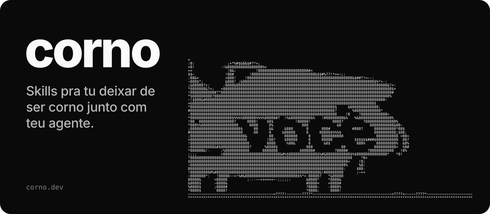

<p align="center">
  
</p>

<p align="center">
  <b>Skills em português para Claude Code e qualquer agente que lê skills.</b><br>
  Ele confere antes de dizer pronto, investiga antes de chutar e larga a cara de IA.<br>
  E ainda julga sua ideia de negócio e seu currículo sem passar pano.
</p>

<p align="center">
  <a href="https://corno.dev">corno.dev</a> ·
  <a href="#instalar">Instalar</a> ·
  <a href="#curral-das-skills">Curral das skills</a> ·
  <a href="CONTRIBUTING.md">Contribuir</a>
</p>

## Instalar

**Claude Code**, dentro de uma sessão:

```
/plugin marketplace add adlernatanael/corno-skills
/plugin install corno@corno
```

**Qualquer agente**: clone e copie as pastas para onde o seu agente lê skills (o exemplo usa a do Claude Code):

```bash
git clone https://github.com/adlernatanael/corno-skills.git ~/corno-skills
cp -R ~/corno-skills/skills/* ~/.claude/skills/
```

Também dá para baixar o `.zip` de uma skill, ou de todas, em [corno.dev](https://corno.dev).

## Curral das skills

Você não precisa chamar pelo nome: fale como sempre falou e o agente puxa a skill certa. A coluna da direita mostra uma frase que dispara cada uma.

### Código

| Skill | O que faz | Diga |
|---|---|---|
| [`corno-confere`](skills/corno-confere/SKILL.md) | Antes de dizer que terminou, roda a verificação agora e mostra a saída. Sem exceção. | “pronto”, “os testes passam” |
| [`corno-testa`](skills/corno-testa/SKILL.md) | Teste primeiro: o que falha, o mínimo que passa, e só então arruma. | “cobre isso com teste” |
| [`corno-investiga`](skills/corno-investiga/SKILL.md) | Bug difícil ou lentidão com método: reproduz, encolhe, testa hipóteses e só corrige com a causa provada. | “funcionava ontem” |
| [`corno-revisa`](skills/corno-revisa/SKILL.md) | Revisão pesada de estrutura e manutenção. Só roda quando chamada pelo nome. | “/corno-revisa” |
| [`corno-pesquisa`](skills/corno-pesquisa/SKILL.md) | Pesquisa em fontes primárias e salva o que achou num Markdown com links. | “o que a doc diz sobre” |

### Interface

| Skill | O que faz | Diga |
|---|---|---|
| [`corno-visagem`](skills/corno-visagem/SKILL.md) | Front-end sênior preguiçoso do jeito certo: o mínimo de código, com o que o projeto já tem e sem cara de IA. | “deixa mais bonito” |
| [`corno-sendo-corno`](skills/corno-sendo-corno/SKILL.md) | Aponta os problemas de UI de uma tela, com arquivo, linha e correção, sem mexer no código. | “aponta os problemas dessa tela” |

### Texto e conversa

| Skill | O que faz | Diga |
|---|---|---|
| [`corno-humano`](skills/corno-humano/SKILL.md) | Reescreve um texto para soar como gente, mantendo o que ele diz e a voz de quem escreveu. | “tá com cara de ChatGPT” |
| [`corno-com-tdah`](skills/corno-com-tdah/SKILL.md) | Responde no formato que uma cabeça com TDAH usa na hora: próxima ação primeiro. | “só me diz o que fazer” |

### Negócio e carreira

| Skill | O que faz | Diga |
|---|---|---|
| [`corno-julgador`](skills/corno-julgador/SKILL.md) | Descubra se sua ideia é digna de um próximo Elon Musk ou só mais um embalador do atacado. | “julga minha ideia” |
| [`corno-recrutador`](skills/corno-recrutador/SKILL.md) | Analisa seu currículo (.pdf, .doc, .docx) ou LinkedIn como um recrutador com 200 na fila. | “analisa meu currículo” |

### Máquina

| Skill | O que faz | Diga |
|---|---|---|
| [`corno-limpa`](skills/corno-limpa/SKILL.md) | Libera espaço no macOS, Windows ou Linux sem apagar o que importa, incluindo o modelo de IA de 4 GB que o Chrome baixa sozinho. | “disco cheio” |

### Para quem cria skills

| Skill | O que faz | Diga |
|---|---|---|
| [`corno-cria-skill`](skills/corno-cria-skill/SKILL.md) | Cria ou finaliza uma skill no padrão deste repositório. | “cria uma skill” |

## O que tem aqui

```
skills/<nome>/       uma pasta por skill: SKILL.md, references/ e scripts/
scripts/             check-skills.mjs, o validador do repositório
site/                a landing de corno.dev (Astro), gerada a partir das próprias skills
assets/              imagens do README
.claude-plugin/      manifesto do plugin e do marketplace do Claude Code
.github/workflows/   CI: valida as skills e builda o site em cada push
```

## Desenvolver

```bash
node scripts/check-skills.mjs          # valida as skills e confere que todas estão neste README
claude plugin validate .               # valida o plugin
cd site && npm install && npm run dev  # site em http://127.0.0.1:5191
```

Quer criar ou mudar uma skill? Leia o [CONTRIBUTING.md](CONTRIBUTING.md) ou peça ao seu agente, que ele usa a `corno-cria-skill`.

<p align="center"><sub>O criador não é corno.</sub></p>
